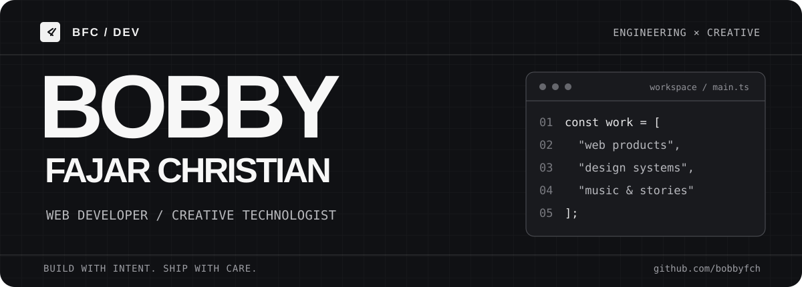
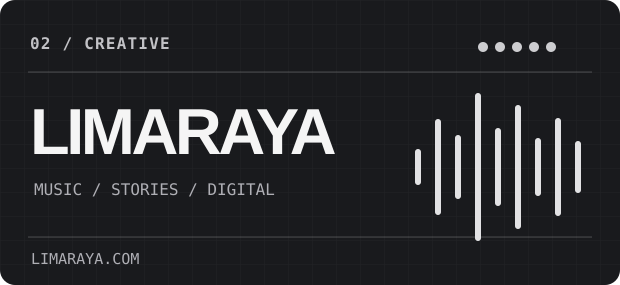

<p align="center">
  
</p>

<p align="center">
  <strong>Engineering the web. Designing the details. Making music.</strong>
</p>

<p align="center">
  I'm Bobby — a developer and creative maker from Indonesia.<br>
  I build web applications, thoughtful interfaces, and independent digital projects.
</p>

<p align="center">
  <a href="https://limaraya.com/">Limaraya</a> &nbsp; / &nbsp;
  <a href="https://sela.limaraya.com/">Sela</a> &nbsp; / &nbsp;
  <a href="https://www.linkedin.com/in/bobbyfajarc/">LinkedIn</a> &nbsp; / &nbsp;
  <a href="https://instagram.com/bobby.fch">Instagram</a>
</p>

---

### 01 / Selected work

<p align="center">
  <a href="https://sela.limaraya.com/"></a>
  <a href="https://limaraya.com/"></a>
</p>

**[Sela](https://sela.limaraya.com/)** — A local-first reading app and embeddable document viewer. Built around privacy, offline access, and a carefully considered reading experience. [Open app](https://sela.limaraya.com/app/).

**[Limaraya](https://limaraya.com/)** — An independent music and storytelling universe, brought to the web through a bilingual, design-led experience. [Explore music](https://limaraya.com/music/).

### 02 / Tech stack

| Area | Tools & technologies |
| :--- | :--- |
| **Frontend** | TypeScript, JavaScript, React, Astro, HTML, CSS, Tailwind CSS |
| **Backend** | PHP, CodeIgniter |
| **Data** | PostgreSQL, MySQL |
| **Tooling** | Node.js, Vite, Git, GitHub |
| **Platform** | Cloudflare Workers, Cloudflare Pages |

### 03 / How I build

```text
$ principles
  clarity over clutter
  performance by default
  accessible, responsive interfaces
  systems that are maintainable
  details that feel intentional

$ intersections
  engineering / interface design / music / storytelling
```

I care about the space where solid implementation meets good taste: clean architecture, useful interactions, and digital experiences that have a reason to exist.

<p align="center">
  <sub>Built with intent. Shipped with care.</sub>
</p>
